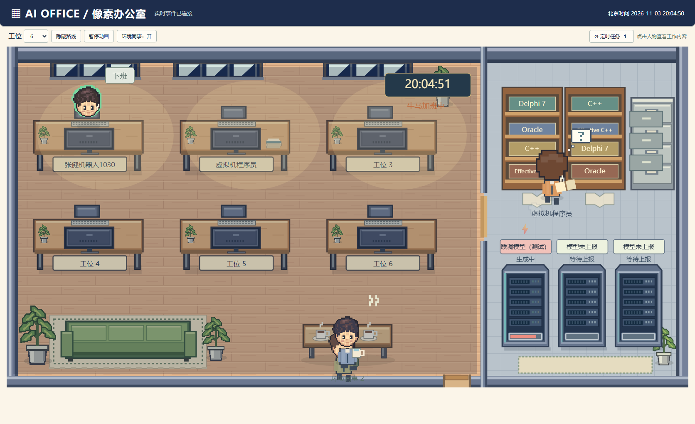
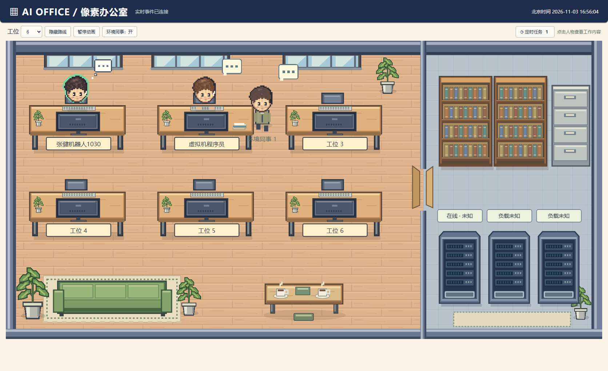

# AI Office · 多人像素办公室

把 AI 角色、任务日志、资料变化和服务负载映射到一间可交互的像素办公室。每位角色有独立工位与身份，支持钉钉多机器人、实时任务上报和定时任务通知。



> 截图来自本地实际运行页面，使用明确标注的接入联调数据，不代表已经连接生产钉钉。生产绑定与 dsh 上报仍需按接入文档配置。

## 当前功能

- **多人角色**：角色可提前注册，闲置时保留工位；支持 6、9、12、18 个工位。
- **办公室交互**：SVG 像素人物、显示器与键盘正确朝向、打字、思考、着急、完成、沿通道寻路、书柜查阅、咖啡桌休息和沙发手机游戏。
- **环境同事**：根据实际角色忙碌比例与已上报服务负载，随机显示1–2位环境角色，散步、沙发休息、喝水或查资料；独立标识、不占真实工位、不参与任务统计，可一键关闭。
- **实际数据驱动**：任务开始、日志与资料归档改变桌面纸堆；进度和服务器负载未上报时保持未知。
- **人物详情**：点击角色后从右侧显示钉钉原始任务、对应会话执行日志与反馈正文，默认只显示地图。
- **定时任务**：触发和结果通知、最近100次运行记录、执行角色跳转，刷新不重复弹历史通知。
- **钉钉多机器人**：企业ID＋应用ID＋机器人编码绑定独立角色，单聊与群聊只改变来源，不根据昵称或senderId合并角色。
- **北京时间**：页面时钟、任务时间线、定时任务记录统一使用 Asia/Shanghai、24小时制，午夜显示00时。
- **生产界面**：默认不显示演示入口；接入任何实际事件后，即使显式开启演示，也会切回实时模式并隐藏模拟控件。

地图内部办公区与资料服务区按7:3组织，不再显示比例标题、底部动作样例和图例。

## 快速启动

需要 Node.js ≥18，无 npm 运行依赖。

Windows PowerShell：

```powershell
git clone https://github.com/shfzhangjian/AI_office.git
Set-Location AI_office
$env:TOWN_DIR = Join-Path $env:USERPROFILE 'ai-office-town'
$env:LT_PORT = '3002'
node server/start.js
```

Linux/macOS：

```bash
git clone https://github.com/shfzhangjian/AI_office.git
cd AI_office
TOWN_DIR="$HOME/ai-office-town" LT_PORT=3002 node server/start.js
```

打开 http://127.0.0.1:3002/town 。统一入口同时启动网页和采集器；同一个TOWN_DIR只允许一个采集器。无角色数据时地图保留空工位，不自动填入假人物。

## 接入文档

| 文档 | 内容 |
|---|---|
| [通用事件接口](docs/API.md) | 角色状态、任务、资料、服务负载、鉴权、幂等回执与上报示例 |
| [钉钉多机器人](docs/DINGTALK_MULTI_BOT.md) | 两角色注册、机器人绑定、dsh接入位置、默认me迁移边界 |
| [定时任务接入与实现](docs/SCHEDULE_INTEGRATION.md) | 生命周期通知、包装器、cron、Windows任务计划、排障 |
| [部署与运行](docs/DEPLOY.md) | 既有PM2部署，以及新版页面、天气和演示策略说明 |
| [更新记录](CHANGELOG.md) | 按版本说明功能、验证与限制 |

### 两个钉钉角色先注册再接入

复制并修改 [config/roster.example.json](config/roster.example.json)，放到运行目录roster.json。示例中的企业ID、应用ID和1030机器人编码是占位符，必须填写真实配置；不填写appSecret或accessToken。

```powershell
$env:TOWN_ROSTER = Join-Path $env:TOWN_DIR 'roster.json'
$env:TOWN_DEFAULT_AGENT_ID = 'zhangjian-1030'
node server/start.js
```

默认角色只用于明确属于1030的旧state.json/任务。虚拟机任务必须提供独立agent_id或完整机器人三元组，不能把全部任务继续交给默认角色。

新增钉钉接口是可信dsh桥接进程的业务上报入口，**不是钉钉原始Webhook回调**。本仓库不负责钉钉登录、Stream建连、回调验签或消息发送，也不会凭空修复钉钉客户端的发送者显示。线上dsh源码不在本仓库，需在该程序的任务流程中接入上报。

### 接口一览

| 方法 | 路径 | 用途 |
|---|---|---|
| POST | /api/town-events | 通用角色注册、状态、任务、资料、服务、定时任务上报 |
| POST | /api/town-dingtalk/events | 经过机器人身份绑定的可信桥接上报 |
| GET | /api/town-inbox/:id | 查询queued/applied与seq |
| GET | /api/town-agents | 查询完整角色投影 |
| GET | /api/town-dingtalk/bindings | 查询当前角色与机器人绑定，不返回密钥 |
| GET | /api/town-services | 服务状态与负载 |
| GET | /api/town-schedules | 最近100次定时运行 |
| GET | /api/town-snapshot | 首屏与重连快照 |
| GET | /api/town-events?after=seq | SSE增量事件 |

POST返回202表示持久化入队，不等于业务执行成功。采集器处理后通过快照和SSE更新页面。

## 环境配置

| 变量 | 用途 | 默认 |
|---|---|---|
| TOWN_DIR | 事件、快照、状态和队列目录 | 用户主目录/ai-office-town |
| LT_HOST / LT_PORT | 监听地址与端口 | 127.0.0.1 / 3002 |
| TOWN_ROSTER | 角色注册与机器人绑定文件 | TOWN_DIR/roster.json |
| TOWN_DEFAULT_AGENT_ID | 旧文件任务的明确默认角色 | 无注册表时兼容me；有注册表时需明确归属 |
| TOWN_WRITE_TOKEN | HTTP写入令牌 | 未设置时仅允许回环来源写入 |
| COLLECTOR_INTERVAL_MS | 采集周期 | 5000 |
| DTASK_DIR | 后台任务目录 | ~/.ai-office/dtask/tasks |
| HB_PORTS | TCP探活，名称:端口逗号分隔 | local-llm:11234,app:3080,panel:3000 |
| TOWN_HTML | 显式指定页面文件 | 优先使用仓库frontend/town.html |
| TOWN_ALLOW_DEMO | 开发时显式开启空数据演示 | 关闭，只有1开启；实际数据到达后关闭 |

生产部署不设置TOWN_ALLOW_DEMO。旧 `?demo=1` 不会在默认部署中开启演示，也不能覆盖已经接入的实际数据。服务重启后读取此环境设置。

页面时间与浏览器、服务器操作系统时区无关。API时间戳推荐使用带Z或偏移的ISO8601；账本可保留UTC，页面统一转换到北京时间。

## 数据与运行原则

```text
可信桥接/业务程序 → HTTP校验 → inbox持久化队列
                                  ↓
文件采集源 ──────────────→ 单个collector → events.jsonl
                                              ↓
                                      角色/运行快照 + SSE
                                              ↓
                                      SVG办公室实时页面
```

- 采集器不修改被监控的服务，网页接口只把上报事件写入队列。
- seq、event_id、幂等键与完整角色投影负责去重和恢复；历史me事件不会自动猜测迁移。
- TCP探活不等于CPU负载。负载、进度及精确资料计数需上游明确提供。
- 咖啡与手机游戏是闲置可视化行为，不表示真实用户正在休息或游戏。
- 角色退役、历史账本/回执清理、多采集器并发不在当前实现范围。
- 远程写入配置TOWN_WRITE_TOKEN及HTTPS入口；读取接口也应由入口配置访问控制，密钥不要放入前端。

## 测试与截图

```bash
node --test tests/*.test.js
```

测试覆盖身份隔离、入队与幂等、状态恢复、资料增减、寻路、定时任务、包装器退出码、北京时间与演示数据隔离。

最新版实际截图：

- [办公室地图](docs/preview.png)
- [人物详情与北京时间](docs/office-latest-detail.png)
- [定时任务运行记录](docs/office-latest-schedules.png)

截图中联调任务均为测试上报；旧截图保留在docs用于历史对照，不再作为当前主预览。

## 授权与历史资料

新版地图、人物及家具由项目SVG代码绘制，代码遵循仓库MIT条款。仓库保留的旧版PNG/WebP素材仍受其原非商用授权约束，不能因新版页面不使用它们就认为全部文件可商用。详见 [LICENSE](LICENSE)。

历史介绍视频因包含运行信息已从当前公开版本移除；[视频制作说明](docs/VIDEO.md)仅保留脚本参考，重新录制时必须使用脱敏数据。旧Canvas页面存档为frontend/town-legacy.html。

## 环境同事与实际角色的区别

环境同事是生产页面允许的装饰动画，不是演示模式。只有接入实际数据且存在真实角色时出现；人物名字和详情明确标注“环境”，不会发送上报、产生任务日志或进入 `/api/town-agents`。

数量策略取“已上报服务负载”与“真实角色忙碌比例”的较大值，仅用于动画密度选择，不冒充CPU实测：70%以上保留1位；40–69%时25%概率显示2位；40%以下65%概率显示2位，其余显示1位。约每60秒重新抽样，负载跨档时提前调整。无实际负载上报时只参考真实角色活动比例。

环境角色共享家具避障与休息位占用检查，真实角色到来时优先让位。可在工具栏关闭“环境同事”，不会影响真实角色、SSE或后台任务。开关仅作用于当前页面，刷新后默认开启。

## 数字人会话日志

人物详情已精简为名称、状态、接收到的钉钉原始任务、执行日志与实际反馈内容；按角色/会话/任务隔离，时间统一北京时间24小时制。原始消息、执行和反馈分别使用message_phase=received/execution/reply，上报方式与dsh接入位置详见 [会话日志协议](docs/CONVERSATION_LOGS.md)。

## 员工讨论与消息动作

真实员工与环境同事都支持交流动画，头顶随机切换交流/想法/疑问/资料等图标。收到“去看看某员工在干啥”“让环境员工1去查资料”“去干活”“去休息”等明确消息时，会沿通道执行对应短时动作，完成后恢复当前业务状态。

这只是前端动画，不执行系统命令或伪造AI之间的实际对话。接入与支持说法见 [消息动作说明](docs/VISUAL_COMMANDS.md)。



## 老板巡视

每隔45分钟，西服老板拿水杯从门口进入，沿通道逐位巡视真实员工和环境同事，每人约1秒“开会/画饼”交流。随机一位会播放约2秒卡通打斗与血条，任意一方归零后结束，老板继续巡视并从原门口离开。

这是独立环境动画，不改变任务、负载或真实智能体统计。路线、计时、恢复和预览方式见 [老板巡视说明](docs/BOSS_PATROL.md)。

### 模型机柜与昼夜办公室

机柜可显示执行会话实际上报的模型名称、思考/生成/闲置/异常状态和动态灯带；资料区增加书本翻录与抽屉动画，门随角色接近开关。地图右上角使用北京时间实时时钟，20:00–08:00 切换夜景、下班和加班怒火，老板夜间巡视更频繁。

**部署端需要给 dsh 接上模型遥测回调**，未上报时显示未知，不推测模型。详见 [模型及昼夜接入文档](docs/MODEL_WORLD_INTEGRATION.md)。
