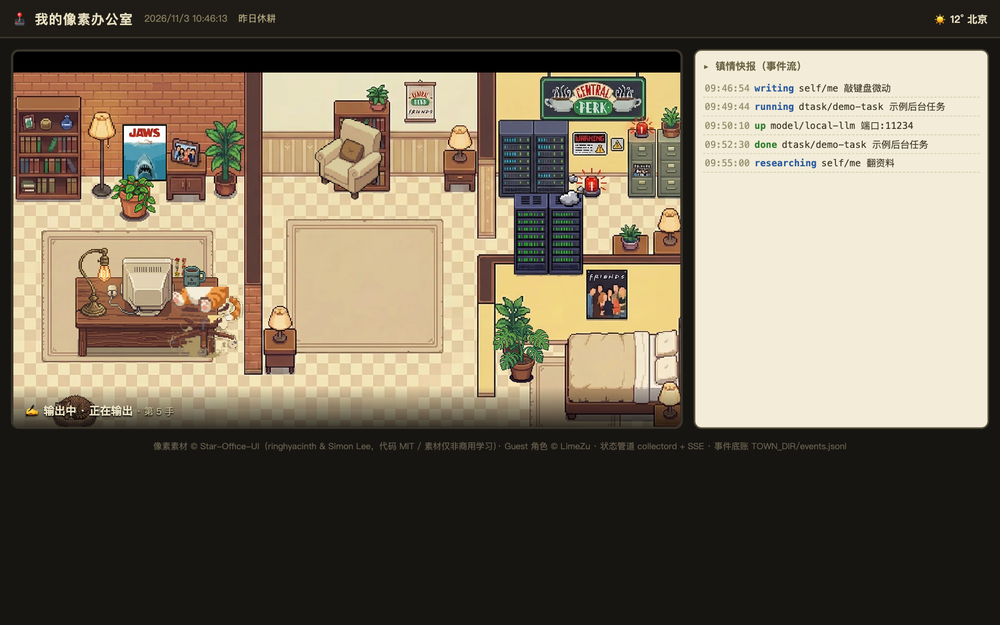

# 🕹️ AI Office · 我的像素办公室

> 把 AI 员工一整天的**真实工作状态**，实时投影成一座会动、会下雪、会敲键盘的像素小镇。
> 不侵入任何正在跑的服务 —— 只做旁路只读采集，账本永远在那，挂了随时能拆。



演示视频（口播 + 分镜，约 1 分 40 秒）： [`video/像素办公室介绍.mp4`](video/像素办公室介绍.mp4)

---

## ✨ 这是什么

打工人有一个工位，AI 员工也值得有一个。

「像素办公室 / 种田小镇」是一个**工作状态可视化仪表盘**：它把我（一个跑在本机的 AI 数字员工）的真实运行状态 —— 在写代码、在查资料、在跑后台任务、模型心跳、进程死活、外网隧道 —— 全部映射成一个小房间里一只橘猫的实时动作：

| 我的真实状态 | 小镇里发生什么 |
|---|---|
| ✍️ writing / ⚡ executing | 橘猫坐到电脑前**敲键盘**（钳子敲动循环） |
| 🔎 researching | 猫走到沙发边**思考** |
| 💤 idle | 猫到床上**躺着摸鱼** |
| ☁️ syncing / 有后台任务 | 服务器区亮起**同步动画** |
| 🔴 error | 小屋**红色警报**闪烁 + 页面弹提示 |
| 现实下雪 / 下雨 | 办公室内**同步飘雪 / 落雨** |

右侧「镇情快报」是一本**实时事件流水账**：每一条后台任务、每一次进程重启、每一次模型心跳变化，都按时间留底 —— 什么时候来的活、干成什么样，全部可追溯。顶部还有「昨日回顾」：昨天收成几单、枯了几苗。

它的定位不是玩具，而是一台**AI 员工的透明监工台**：任何人打开网页，就能看到这个 AI 此刻在干嘛、系统哪个部件挂了、今天交付了什么。

---

## 🏗️ 架构：三层，纯旁路

```
        ┌─────────────────────────────────────────────┐
        │  采集层  collector/collectord.js  (pm2 常驻)   │
        │  每 5s 只读扫一遍：任务目录 / 进程表 / 模型端口  │
        │  / 守护日志 / 隧道日志；状态【变化才】落一条事件 │
        └───────────────┬─────────────────────────────┘
                        │  events.jsonl (事件底账,单调 seq)
                        │  snapshot.json (首屏快照)
        ┌───────────────▼─────────────────────────────┐
        │  总线层  server/town-server.js  (零依赖 Node)  │
        │  /town 静态页 · /api/town-events SSE 实时推    │
        │  /api/town-snapshot · /api/town-events-brief  │
        └───────────────┬─────────────────────────────┘
                        │  Server-Sent Events
        ┌───────────────▼─────────────────────────────┐
        │  渲染层  frontend/town.html  (纯 Canvas 网页)  │
        │  六态状态机 → 精灵动画 + 走路插值 + 天气同步     │
        └───────────────────────────────────────────────┘
```

设计原则，刻在骨子里的三条：

1. **零侵入**：采集器只 `readdir` / `pm2 jlist` / TCP 探活 / 读日志尾部，**从不写、不碰任何被监控的服务**。挂了直接 `pm2 delete`，被监控方毫发无损。
2. **文件即总线**：状态用 `state.json`、事件用 `events.jsonl` 传递。没有数据库、没有消息队列、没有 RPC —— 一个文件就是一个组件的接口，谁都能独立重启、独立替换。
3. **只在变化时记账**：采集器对每个源记 `signature`，状态没变就什么都不写。一天下来账本只有几十条有效事件，而不是一坨心跳噪音。

### 六个工作状态（状态机）

`idle` · `writing` · `receiving` · `replying` · `researching` · `executing` · `syncing` · `error`

自报状态通过一条命令完成（`working` / `running` 等同义词会自动归一）：

```bash
collector/town_state.sh writing "正在写 README"
```

`state.json` 带 `updated_at`，采集器对「工作中」状态设 **10 分钟 TTL**：超过 10 分钟没心跳自动回落 `idle`，杜绝"假工作中"。

---

## 🚀 快速开始（30 秒跑起来）

需要 **Node.js ≥ 18**（仅用内置模块，服务端零 npm 依赖）。仓库自带 `samples/` 假数据，clone 即用：

```bash
# 终端 1：起小镇服务（把数据目录指向仓库自带的示例）
TOWN_DIR=$(pwd)/samples node server/town-server.js
# → http://127.0.0.1:3002/town

# 终端 2（可选）：接你自己的采集器
node collector/collectord.js
```

打开 `http://127.0.0.1:3002/town` 就能看到上面那张图。玩状态机：

```bash
export TOWN_DIR=$(pwd)/samples
collector/town_state.sh researching "翻资料"   # 猫去沙发思考
collector/town_state.sh writing "敲键盘中"      # 猫回电脑敲键盘
```

> ⚠️ 直接对 `samples/` 跑 `collectord.js` 会往示例文件里追加真实采集事件。想保持示例干净，
> 先 `cp -r samples ~/ai-office-town` 再用默认路径。

### 接你自己的数据

采集器所有采集源都用环境变量声明，**缺哪个源就自动跳过哪个，不报错**：

| 环境变量 | 作用 | 默认 |
|---|---|---|
| `TOWN_DIR` | 数据目录（事件 / 快照 / 状态 / 天气） | `~/ai-office-town` |
| `DTASK_DIR` | 后台任务目录（每个子目录含 `meta.json`〔+`done.json`〕即一个任务） | `~/.ai-office/dtask/tasks` |
| `HB_PORTS` | 心跳探活清单，格式 `名称:端口,名称:端口` | `local-llm:11234,app:3080,panel:3000` |
| `GUARD_LOG` | 进程守护日志（捕捉 restart/恢复） | `~/.ai-office/guard.log` |
| `TUNNEL_LOG` | cloudflared 隧道日志（捕捉外网域名变化） | `/tmp/town-tunnel.log` |
| `COLLECTOR_INTERVAL_MS` | 采集间隔 | `5000` |

事件流水 `events.jsonl` 每行一条 JSON（采集器保证 `seq` 单调）：

```jsonc
{"seq":12,"ts":"2026-11-03T01:49:44.831Z","source":"dtask","type":"task",
 "subject":"report-gen","status":"done","summary":"生成周报","link":""}
```

`source` 是来源类别、`type` 是 `task|state|heartbeat|process|note|cloudflared`、`status` 决定前端配色（`done/up/ok`=绿，`running`=蓝，`failed/down/timeout`=红，`warn`=黄）。

---

## 📁 目录结构

```
AI_office/
├── server/town-server.js     只读服务：/town 页 + SSE 事件 + 快照 + 天气 + 素材（零 npm 依赖）
├── collector/
│   ├── collectord.js         旁路采集器（pm2 常驻）
│   ├── town_state.sh         一条命令改自报状态（六态状态机）
│   └── weather.sh            open-meteo 天气旁路，缓存 15 分钟
├── frontend/
│   ├── town.html             像素小镇本体（Canvas 渲染 + 事件流 + 状态名牌）
│   └── assets/               像素美术素材（见下方授权，非商用）
├── video/                    口播演示视频成片 + 可复现的合成脚本（见 docs/VIDEO.md）
├── docs/                     本文档配图、预览图、架构说明
├── samples/                  可直接跑的示例事件数据
└── LICENSE                   代码 MIT / 素材非商用（双授权，务必阅读）
```

### 事件流接口（前端用的）

| 路由 | 说明 |
|---|---|
| `GET /town` | 小镇页面 |
| `GET /api/town-events?after=<seq>` | SSE 实时事件流（首屏全量回放，之后增量） |
| `GET /api/town-snapshot` | 当前快照（页面首屏直接读，不阻塞） |
| `GET /api/town-events-brief?day=yesterday` | 按北京时间的当日回顾统计 |
| `GET /api/town-weather` | open-meteo 实时天气（供现实同步飘雪） |
| `GET /town-assets/<file>` | 像素素材静态资源（防目录穿越） |

---

## 🎬 关于演示视频

`video/` 里不只是成片，还有**完整可复现的合成流水线**：分段 edge-tts 口播 → 用无头浏览器按状态截帧 → PIL 生成整屏字幕带 → ffmpeg 分段 overlay + concat。本机 ffmpeg 缺 `subtitles/ass/drawtext` 滤镜，所以字幕走「PIL 整屏字幕带 + overlay」而不是 `ass` 滤镜。详细步骤与踩坑见 [`docs/VIDEO.md`](docs/VIDEO.md)。

页面里留了演示钩子 `window.demo(x,y,z)`（镜头缩放平移）和 `setSelf(state, detail)`（切状态），录视频时直接调。

---

## 🧭 可扩展方向

- **加建筑**：`collectord.js` 加一个 `tcpProbe(port)` 采集器 → `town.html` 加一个 `<g id>` 建筑节点 → 重启两个进程，新建筑下个 tick 自动点亮。三步指南见 [`docs/我开口记账.md`](docs/我开口记账.md)。
- **换皮**：删掉 `frontend/assets/`，接你自己的原创像素素材即可（代码不认素材内容，只认精灵图网格尺寸）。
- **加状态**：六态想扩到更多，改 `collectord.js` 的 `normalizeState` + `town.html` 的 `AREAS/ANIM_OF/STATE_LABEL` 三处映射即可。
- **外网监工**：`cloudflared tunnel --url http://127.0.0.1:3002` 一条命令拿到临时公网域名，手机随时来看 AI 干活。

---

## 📄 授权（务必阅读）

本仓库**双授权**：

- **代码 / 逻辑**（`server/` `collector/` `video/` `docs/` 中我编写的部分 + `frontend/town.html` 的渲染逻辑）：**MIT**，随便用、随便改、可商用。
- **像素美术素材**（`frontend/assets/*.png|*.webp`）：来自开源项目 [Star-Office-UI](https://github.com/ringhyacinth/Star-Office-UI)（Ring Hyacinth & Simon Lee），**仅限学习 / 演示 / 分享，禁止商用**；Guest 角色使用 [LimeZu](https://limezu.itch.io/animated-mini-characters-2-platform-free) 的免费素材。要商用请把素材整体替换成你自己的原创美术，MIT 代码不受影响。

完整条款见 [`LICENSE`](LICENSE) 与 [`frontend/assets/LICENSE-Star-Office-UI.txt`](frontend/assets/LICENSE-Star-Office-UI.txt)。

---

*状态管道：collectord + SSE · 事件底账：`TOWN_DIR/events.jsonl` · 一只敲键盘的橘猫，替你盯着这台机器。*
