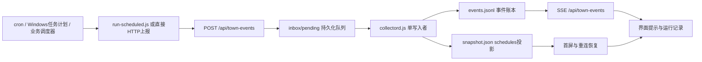

# 定时任务通知：详细接入与实现文档

适用版本：AI_office 多人办公室。本文说明已有调度器如何把任务触发、执行与结果接入办公室界面。项目负责接收和展示运行事件，任务触发时间仍由原调度器管理；本次未创建或修改任何系统定时任务。

## 1. 界面行为

- 工具栏右侧新增“定时任务”按钮：有 triggered/running 运行时显示运行数量，否则显示保留的运行记录数。
- 首次收到某次运行的 triggered 事件，右上角弹出通知；done、failed、missed 结果也显示通知。
- running 更新记录但不额外弹窗，避免同一执行重复提示；同一 run_id 的重复触发不重复弹窗。
- 通知最多同时 4 条，8 秒后消失，可手动关闭或点击查看记录。
- 点击工具栏入口，右侧展开记录面板；与角色详情互斥，不占据地图的固定宽度。打开记录面板会收起现有浮动通知；面板展开时新结果直接更新记录，不叠加通知遮挡标题。
- 记录包含任务名称、状态、计划时间、实际触发时间、结束时间、摘要和运行 ID。绑定 agent_id 时可跳转执行角色；角色需另外通过 state/task 事件上报。
- 页面刷新或断线恢复时，从快照恢复最近 100 次运行，不重新弹出历史触发提示；未开启网页期间的任务可在记录中查看。
- 界面时钟、任务时间线与运行记录固定按 Asia/Shanghai、24小时制显示，午夜为00时；事件时间必须带时区，不使用执行主机的本地时区猜测。
- 生产默认无演示入口，接入实际数据后隐藏所有模拟控件。仅显式开启TOWN_ALLOW_DEMO=1且无实际事件的开发环境可模拟触发；不会执行真实命令。
- 角色动画暂停不会阻止真实定时任务通知；减少动态效果设置不影响文本通知。

## 2. 接入结构与文件职责



| 文件 | 职责 |
|---|---|
| server/ingest.js | 校验 schedule 事件、鉴权、幂等处理与持久化入队 |
| collector/collectord.js | 统一分配 seq、记账、按 run_id 归并运行生命周期、生成快照 |
| server/town-server.js | SSE、快照及 GET /api/town-schedules |
| frontend/town.html | 通知去重、记录面板、角色跳转、历史恢复 |
| collector/run-scheduled.js | 外部命令包装执行与生命周期上报 |
| collector/report.js | 单条 JSON 事件上报工具 |
| tests/api.test.js | 字段校验、HTTP入队、生命周期持久化验证 |
| tests/character.test.js | 浏览器逻辑层通知去重和历史恢复验证 |
| tests/scheduled-wrapper.test.js | 包装脚本成功/失败与退出码验证 |

## 3. 启动服务

Node.js ≥18，不需要 npm 包。网页服务与采集器必须共享 TOWN_DIR，并且只允许一个采集器写该目录。

```powershell
Set-Location E:/live/AI_office
$env:TOWN_DIR = 'E:/live/AI_office-runtime'
$env:LT_PORT = '3012'
$env:COLLECTOR_INTERVAL_MS = '1000'
node server/start.js
```

本地访问：`http://127.0.0.1:3012/town`，使用实时模式。

如果只有网页服务，没有采集器，POST 会返回 queued，界面暂不更新；采集器恢复后会继续处理。端到端显示延迟通常包含一个采集周期，发生采集阻塞或断线重试时可能更久。

## 4. HTTP 事件协议

沿用统一写入接口：`POST /api/town-events`，Content-Type 为 application/json。单条请求不超过 16 KiB。

### 字段说明

| 字段 | 必填 | 规则与用途 |
|---|---|---|
| type | 是 | 固定 schedule |
| subject | 是 | 调度任务 ID；相同任务每次运行保持一致，最大100字符 |
| run_id | 是 | 本次执行的唯一 ID，最大100字符；不同运行、不同任务不得复用 |
| status | 是 | triggered / running / done / failed / missed |
| job_name | 否 | 界面任务名，最大160字符，缺省显示 subject |
| scheduler | 否 | 调度器名称，例如 cron、windows-task-scheduler、业务调度器，最大80字符 |
| agent_id | 否 | 执行角色 ID；不会单凭 schedule 事件创建或驱动人物 |
| scheduled_for | 否 | 计划执行时间，ISO 8601，必须带 Z 或 ±HH:MM 时区 |
| started_at | 否 | 实际开始时间，同上 |
| finished_at | 否 | 结束时间，同上 |
| timezone | 否 | 有效 IANA 时区，例如 Asia/Shanghai；记录来源时区，界面仍按北京时间显示 |
| summary | 否 | 简短说明，最大2000字符 |
| detail | 否 | 详细结果，最大4000字符；避免放入密码或敏感输出 |

seq、ts、event_id、source 由服务端与采集器生成，不由调用方控制。ts 是采集器记账时间；triggered_at 由首次 triggered 事件的 ts 派生，包含上报与队列处理延迟，不等于调度器毫秒级启动时间。精确开始时间应使用 started_at。

### 生命周期

正常：`triggered → running → done`；异常：`triggered → running → failed`；调度器发现漏执行时可上报 missed。

同一 run_id 的多条事件归并为一条记录，保留已有的计划时间、名称和首次触发时间。done/failed/missed 后的迟到 triggered/running 不会把结果回退成运行中；再次上报终态时以后到的结果为准。相同 subject 的下一次执行必须使用新的 run_id。

系统不会自动推断漏执行，也不会在没有结束事件时擅自标记失败。missed 必须由调度器或监控程序主动上报。

### 触发示例

```json
{
  "type": "schedule",
  "subject": "daily-report",
  "run_id": "daily-report-20261104T090000+0800-001",
  "job_name": "每日经营日报",
  "status": "triggered",
  "scheduler": "cron",
  "agent_id": "report-agent",
  "scheduled_for": "2026-11-04T09:00:00+08:00",
  "timezone": "Asia/Shanghai",
  "summary": "定时触发经营日报任务"
}
```

### 开始执行

```json
{"type":"schedule","subject":"daily-report","run_id":"daily-report-20261104T090000+0800-001","status":"running","started_at":"2026-11-04T09:00:02+08:00","summary":"开始处理日报"}
```

### 成功或失败

```json
{"type":"schedule","subject":"daily-report","run_id":"daily-report-20261104T090000+0800-001","status":"done","finished_at":"2026-11-04T09:03:12+08:00","summary":"日报生成完成"}
```

```json
{"type":"schedule","subject":"daily-report","run_id":"daily-report-20261104T090000+0800-001","status":"failed","finished_at":"2026-11-04T09:03:12+08:00","summary":"日报生成失败","detail":"数据源连接超时"}
```

成功和失败是不同结果示例，不应在同一次成功运行中同时上报。

## 5. 鉴权、重试与回执

未配置 TOWN_WRITE_TOKEN 时，仅允许回环来源写入；跨源浏览器写入被拒绝。远程接入需配置写入令牌、HTTPS入口与读取访问控制，不能把写入令牌放在网页代码里。此令牌与 GitHub 令牌无关。

建议使用每次运行、每个阶段独立的 Idempotency-Key：

- `schedule:<run_id>:triggered`
- `schedule:<run_id>:running`
- `schedule:<run_id>:done` 或 `schedule:<run_id>:failed`

网络重试必须复用原键和完全相同的请求内容。相同键相同内容返回原回执，不重复入账；相同键内容改变返回409。下一次定时执行使用新的 run_id，不能沿用昨天的键。

202 返回表示已持久化排队：

```json
{"id":"回执ID","status":"queued","status_url":"/api/town-inbox/回执ID"}
```

查询 status_url，applied 表示已记入账本，seq 可与 SSE 对照。幂等重试遇到已处理事件时直接返回200。不能把202当作业务任务执行成功。

| HTTP | 处理方式 |
|---|---|
| 400 | 检查 run_id、状态、长度、时间格式与时区，不盲目重试 |
| 401 / 403 | 检查令牌、来源地址和跨源限制 |
| 409 | 同一幂等键对应不同内容；修正调用逻辑 |
| 413 / 415 | 缩小请求或改用正确 Content-Type |
| 503 / 网络超时 | 保持原幂等键和内容，有限重试；需要可靠交付时使用调用端持久化队列 |

## 6. 推荐接法：包装已有命令

无需改造任务主体，把原命令放到 `--` 后面：

```powershell
$env:TOWN_URL = 'http://127.0.0.1:3012'
node E:/live/AI_office/collector/run-scheduled.js --job-id daily-report --name '每日经营日报' --agent-id report-agent --scheduler windows-task-scheduler -- node E:/jobs/daily-report.js
```

参数：

- --job-id 必填；--name、--agent-id、--scheduler、--scheduled-for 可选。
- `--` 后是可执行程序和原始参数，shell:false，不解释 shell 管道、重定向或命令拼接。
- 推荐使用 node/python/程序本体的绝对路径；需要运行 .cmd、PowerShell 或 shell 脚本时显式调用对应解释器。
- 未传 --scheduled-for 时使用包装器启动时间，不能据此计算真实调度延误；如需计划时刻对比，由调度器传入计划时间。
- TOWN_TIMEZONE 默认 Asia/Shanghai；TOWN_WRITE_TOKEN 可配置写入令牌。
- 每次包装执行默认生成新的 UUID。可通过 TOWN_RUN_ID 传入外部运行 ID，必须保证每次实际执行唯一。

自动上报顺序：triggered、running、业务程序执行、done/failed。提供 agent-id 后还会上报 task running 和 task done/failed，让人物动作与资料数量联动。执行输出直接传给原控制台，不自动上传完整日志。

包装器每条通知最多尝试2次，每次请求超时3秒；通知失败只向 stderr 写警告，不把成功业务改成失败。triggered 上报位于执行前，API不可用时可能增加最多约6秒启动延迟。最终进程退出码保持业务程序退出码；收到终止信号时尝试转发给直接子进程，不保证清理子进程创建的整个进程树。

如果包装器被强制结束、断电或通知均失败，可能没有终态通知；应由调度器的失败回调或外部巡检补报 failed/missed。包装器本身没有离线持久化补偿队列。

### cron 示例

以下仅为配置示例，未替用户安装：

```cron
0 9 * * * TOWN_URL=http://127.0.0.1:3012 /usr/bin/node /opt/AI_office/collector/run-scheduled.js --job-id daily-report --name daily-report --scheduler cron --agent-id report-agent -- /usr/bin/node /opt/jobs/daily-report.js >> /var/log/daily-report.log 2>&1
```

cron 的时区和工作目录由部署环境决定。需要固定计划时刻时，让调度器或启动脚本生成带时区的 --scheduled-for，避免硬编码过期日期。保证日志目录权限；命令示例中不存在写入令牌。

### Windows 任务计划程序

在原任务的操作中配置：

- 程序：本机 node.exe 的绝对路径。
- 参数：`E:/live/AI_office/collector/run-scheduled.js --job-id daily-report --name 日报 --agent-id report-agent --scheduler windows-task-scheduler -- C:/Program Files/nodejs/node.exe E:/jobs/daily-report.js`。
- 实际路径带空格时，在任务参数界面为该路径加双引号，例如 `"C:/Program Files/nodejs/node.exe"`。
- 起始位置：业务任务需要的工作目录。
- TOWN_URL/TOWN_WRITE_TOKEN：通过任务用户环境或受保护的启动脚本配置，不把令牌写到截图或日志。
- 定时器触发规则、失败重试、禁止重叠运行仍由 Windows 任务计划程序管理。

## 7. 直接改造调度器回调

已有业务调度框架可在回调中直接 POST。下面是仅依赖 Python 标准库的发送函数：

```python
import json, os, urllib.request

def report_schedule(event, phase):
    url = os.getenv('TOWN_URL', 'http://127.0.0.1:3012').rstrip('/')
    headers = {
        'Content-Type': 'application/json',
        'Idempotency-Key': f"schedule:{event['run_id']}:{phase}",
    }
    token = os.getenv('TOWN_WRITE_TOKEN')
    if token:
        headers['Authorization'] = 'Bearer ' + token
    body = json.dumps(event, ensure_ascii=False).encode('utf-8')
    request = urllib.request.Request(url + '/api/town-events', body, headers, method='POST')
    with urllib.request.urlopen(request, timeout=5) as response:
        return json.load(response)
```

业务侧在定时回调开始先发送 triggered，在实际执行前发送 running，在 try/except 的成功与异常分支发送 done/failed；使用同一 run_id。该函数不内置重试，生产调用方按第5节实现有限重试或持久化补偿，避免通知异常中断原业务。

如果调用方自己管理角色任务，另发 task/state 事件即可；schedule 事件只描述调度执行，不强制改变某个角色的状态，也不凭空增加桌面资料。

## 8. 查询与恢复

- GET /api/town-schedules：`{updated, items}`，最近100次运行，按最后事件序号倒序。
- GET /api/town-snapshot：增加 schedules 数组，供首次加载和重连恢复。
- GET /api/town-events?after=seq：收到 type=schedule 即更新通知和记录。
- 采集器重启：扫描账本重建运行记录；同一 subject 的多个 run_id 独立保留。
- HTTP写入与采集器不并发写同一账本，所有上报先入队；event_id 用于崩溃窗口中的去重。
- 界面与快照仅保留最近100次运行，账本与回执仍在运行目录。当前版本没有自动清理或归档策略，应在停写并备份后按部署要求维护。

## 9. 验收清单

1. 启动统一入口，打开实时页面。
2. 发送一条新的 triggered：确认右上角通知和工具栏运行计数。
3. 用同一 Idempotency-Key 重试：确认不新增运行、不重复通知。
4. 发送 running：记录变更，不新增触发弹窗。
5. 发送 done 或 failed：出现结果通知，运行计数减少。
6. 点击记录，核对计划时间、触发时间、结束时间和 run_id；点击执行角色验证跳转。
7. 刷新页面：记录仍在，不重复弹出历史通知。
8. 使用新的 run_id 触发同一 subject：应新增一次运行。
9. 临时停掉采集器后上报：返回 queued；恢复后记录应出现。
10. 运行 `node --test tests/*.test.js`：当前测试覆盖接口校验、投影恢复、通知去重、包装器成功/失败及原有地图与SSE功能。

Chrome 实际验证截图：`docs/office-schedule-trigger.png`、`docs/office-schedule-history.png`。当前本地记录“定时通知联调（测试）”为主动上报的测试记录，非生产计划任务。

## 10. 常见问题

- **没有提示但接口202成功**：检查采集器是否启动、TOWN_DIR是否一致、网页是否处于实时模式，再查 status_url。
- **刷新后不弹窗**：这是预期行为，历史运行保留在记录面板；只有新到达的生命周期事件弹窗。
- **一直运行中**：上游没有发送结束事件，或结束通知发送失败；检查业务退出和上报日志。
- **没有人物动作**：schedule.agent_id仅用于关联；使用包装器的 --agent-id 或自行发送 task/state。
- **角色入口提示尚未上报**：该角色还不存在，或工位已满；先上报角色状态或增加工位。
- **计划时间显示未上报**：调用方未提供 scheduled_for，单次回调无法从任务名称推导 cron 计划。
- **触发时间存在少量延迟**：triggered_at是采集入账时间；精确执行时刻使用 started_at，并结合调度器日志核对。
- **重试报409**：同一幂等键的请求内容变了，常见原因是每次重试重新生成时间戳；缓存原始事件并复用。
